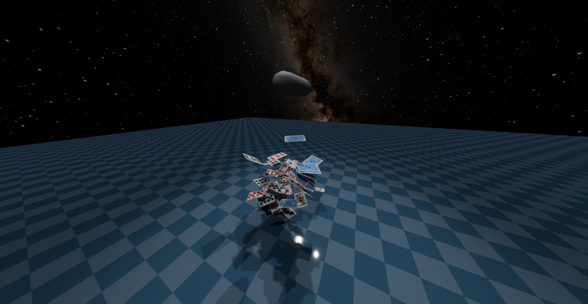

English | [简体中文](README.zh-CN.md)

# MuJoCo WASM Play: Simulate in the browser

[Recommended demo page](https://lshdlut.com/en/demos/play/) | [Direct GitHub Pages app](https://lshdlut.github.io/mujoco-wasm-play/index.html?model=rkob&ver=3.15.0&forgeBase=https://cdn.jsdelivr.net/gh/lshdlut/mujoco-wasm-forge@592e1d9ae39587b6697b39387d1a4ec2699bc56a/deliverables/3.15.0/)

> **Documentation (Sphinx / Read the Docs)**: source lives in [`doc/en/`](doc/en/) and [`doc/zh/`](doc/zh/). Read online: [EN](https://mujoco-wasm-play.readthedocs.io/en/latest/) | [ZH](https://mujoco-wasm-play.readthedocs.io/zh-cn/latest/).

## Overview

A performance-first MuJoCo viewer that brings most of the **MuJoCo Simulate** workflow to the web: open a URL and start simulating. Powered by `mujoco-wasm-forge`.

## Highlights

- **Simulate-style UI in the browser**: panels and controls closely match MuJoCo Simulate, but run anywhere a browser can run.
- **Shareable, zero-install demos**: reproducible links via URL parameters (`model=`, `forgeBase=`).
- **Performance-first runtime**: MuJoCo runs in a Worker; the built-in HUD (press `F2`) exposes CPU timing (ms/step), solver stats, FPS, memory.
- **Extensible framework**: plugins can add native-style foldable sections, panel actions, and 3D overlays without forking the viewer.

## Performance

Historical MuJoCo 3.5.0 reference numbers (best of 5 runs; each run reports the median; lower is better), measured interactively (rendered, not headless) after 35s warm-up + 8s sampling, with both side panels collapsed. Current default Play uses MuJoCo 3.15.0. CPU time is reported as ms/step in the Simulate-style HUD (press `F2`, while Running). Numbers vary with hardware, browser, and power/thermal settings.

> Important: browser extensions and site-level features (e.g. enhanced security modes / efficiency or power-saving modes) can heavily impact Worker/WASM timing, and may affect the GitHub Pages demo more than `localhost`. For fair comparisons, try a private window, disable extensions, and keep the tab in the foreground.

| Model | Native `simulate` (ms/step) | Web Play (ms/step) |
|---|---:|---:|
| `cards` | 0.542 | 0.580 |
| `humanoid` | 0.062 | 0.078 |

## Quickstart

- Local dev (serve repo root on port 8000):
  - `python tools/dev_server.py --root . --port 8000`
  - `http://127.0.0.1:8000/index.html?model=rkob`
- Recommended demo page:
  - `https://lshdlut.com/en/demos/play/`
- Direct static app (GitHub Pages, retained):
  - `https://lshdlut.github.io/mujoco-wasm-play/index.html?model=rkob&ver=3.15.0&forgeBase=https://cdn.jsdelivr.net/gh/lshdlut/mujoco-wasm-forge@592e1d9ae39587b6697b39387d1a4ec2699bc56a/deliverables/3.15.0/`
- Plugins: experimental. See `doc/en/reference/plugin_contract.md`. SmoCap is a separate demo at [lshdlut.com/smocap2026](https://lshdlut.com/smocap2026), not a built-in Play plugin.

## Models

- `model=` accepts either a `.xml` path under `model/` (or `local_model/` for local-only files) or an alias: `rkob`, `raj`, `humanoid`, `humanoid100`, `cards`, `sensor`.
- Packaged model shortcuts come from `backend/model_candidates.mjs`; to ship a model with the static app, add the XML under `model/` and include it in `MODEL_POOL`.

## Plugins

Status: experimental.

This repo can optionally load external UI/plugins without forking. Start from `doc/en/reference/plugin_contract.md` for the contract (mounts, Host API, section registry, UI kit primitives, worker constraints, and 3D overlays).

## Forge dist

This is required.

Forge repo: `https://github.com/lshdlut/mujoco-wasm-forge`

- This repo does not ship MuJoCo WASM binaries; it expects a forge `dist/<ver>/` bundle.
- Set the dist base via `forgeBase=` (recommended) or `window.__FORGE_DIST_BASE__` (must be set before the main module runs).
- Local and aggregator dist base is `/forge/dist/{ver}/`. Bare GitHub Pages uses the immutable Forge commit `592e1d9ae39587b6697b39387d1a4ec2699bc56a`, matching `forge-3.15.0-r1`, under `deliverables/{ver}/`. `{ver}` comes from `site_config.js` (`globalThis.PLAY_VER`) or `ver=...`.
- The dev server (`tools/dev_server.py`) mounts `/forge/` to a sibling `../mujoco-wasm-forge` checkout if present (otherwise it falls back to this repo root).
- This viewer requires a forge build with viewer extensions (scene + vopt pointers).
- Current default baseline: MuJoCo 3.15.0. The core suite includes external OBJ mesh smoke coverage for 3.6.0 through 3.15.0; 3.15.0 also has single-thread and pthreads load-lifecycle and textured-bundle regressions.
- Typical remote base template (jsDelivr + pinned forge commit): `https://cdn.jsdelivr.net/gh/lshdlut/mujoco-wasm-forge@<sha>/deliverables/{ver}/`
- Cache debugging: append `cacheBust=always` to force cache-busting for the Worker URL and forge resource URLs. Default is cache-friendly (no `cb=...`).

### Pthreads variant

- Entry: `/pthreads/index.html`
- Default dist base: `/forge/dist/{ver}/pthreads/`
- Requires cross-origin isolation (`crossOriginIsolated === true`) via COOP/COEP headers.

## Visual sources

Lighting and skybox sources.

- `model` (default): MuJoCo-driven skybox/lights from the loaded model.
- `preset-sun` / `preset-moon`: built-in HDRI presets shipped as static assets in this repo (forge does not include HDRIs as part of `dist/<ver>/`).
- Override preset HDRI/EXR hosting via `envAssetBase=` or `globalThis.PLAY_ENV_ASSET_BASE` (for example a shared CDN or R2 bucket). If remote env assets fail to load, Play keeps the preset lighting and falls back to the cached/gradient environment path.

## Development

- UI artifacts: `node tools/generate_ui_artifacts.mjs`
- Worker protocol artifacts: `node tools/generate_worker_protocol.mjs` (generates `worker/protocol.gen.mjs`, `worker/dispatch.gen.mjs`)
- Local Forge compatibility check: `npm run check:forge-abi` compares generated metadata with the pinned Forge ABI snapshot.
- GitHub Pages does not provide COOP/COEP. The `/pthreads/` entry requires cross-origin isolation and refuses to start without it.
- The 3.15 compatibility path maps multi-input actuator control slots, uses native `mj_resetCtrl` for **Clear all** when available (with a zero neutral fallback), and exposes native `mjtIntegrator` names/values to the Worker/UI.
- Non-zero native plugin-state round trips are not covered by the supplied bundles; exact IPC replay is not supported. Web Profiler/Sensor paths remain partial, and external UI plugins are separate from native MuJoCo plugins.

## Acknowledgements

- Preset environment assets are sourced from [Poly Haven](https://polyhaven.com/) under CC0. Thanks to Poly Haven.

## License

- This repo is licensed under [MIT](LICENSE).

## Testing

- `tests/unit/`: Node unit tests (fast, dependency-free)
- `tests/e2e/`: Playwright end-to-end tests
- Smoke: `npm run smoke`
- Full E2E: `npm run test:e2e`
